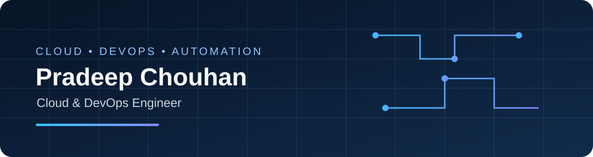

## Professional Summary

Cloud & DevOps practitioner focused on building, deploying, and operating cloud-native applications. Hands-on project work across AWS infrastructure, Kubernetes, Infrastructure as Code, containerization, CI/CD, and observability.

**Core focus:** AWS · Amazon EKS · Kubernetes · Terraform · Docker · GitHub Actions · Jenkins · Prometheus · Grafana · Loki

---

## Technical Skills

| Domain | Technologies |
|---|---|
| Cloud | AWS (EKS, EC2, S3, CloudFront, RDS, ElastiCache, Secrets Manager) |
| Infrastructure as Code | Terraform |
| Containers & Orchestration | Docker, Kubernetes, Amazon EKS |
| CI/CD & Version Control | GitHub Actions, Jenkins, Git |
| Networking & Web | VPC, VPC Peering, NGINX, Ingress |
| Observability | Prometheus, Grafana, Loki |
| Development | Java, Spring Boot, JavaScript, React, Node.js, Python |
| Databases & Cache | PostgreSQL, MongoDB, Redis |

---

## Selected Projects

### 01 · Task Management Application — Amazon EKS
A containerized full-stack application deployed on Kubernetes with AWS infrastructure.

- Provisioned AWS infrastructure using Terraform, including VPC networking and peering.
- Deployed workloads on Amazon EKS and configured NGINX ingress.
- Integrated RDS PostgreSQL and AWS Secrets Manager.
- Explored workload scaling with Karpenter.
- Implemented metrics and log observability using Prometheus, Grafana, and Loki.

[View Task Management repository →](https://github.com/chouhanpradeep720-ai/Task-Mgmt-App)

### 02 · Wanderlust Mega Project
Full-stack travel application with an AWS deployment architecture.

- Frontend delivery through S3 and CloudFront.
- Backend deployment planned on Elastic Beanstalk.
- PostgreSQL database on Amazon RDS and Redis caching with ElastiCache.
- Docker-based development and environment configuration.

[Browse repositories →](https://github.com/chouhanpradeep720-ai?tab=repositories)

### 03 · Chattingo
Full-stack chat application built with React and Java/Spring Boot.

- Frontend and backend integration through APIs.
- Chat and messaging workflows.
- Backend testing, debugging, and Docker Compose-based local development.

[Browse repositories →](https://github.com/chouhanpradeep720-ai?tab=repositories)

---

## GitHub Statistics

 

---

## 🏆 GitHub Trophies

*Community-generated trophy cards reflect public GitHub activity. They are not formal certifications or awards.*

## Contribution Activity

---

## Practical Highlights

- AWS infrastructure design and deployment through hands-on projects.
- Kubernetes workload deployment, ingress, and scaling concepts.
- Terraform-based infrastructure automation.
- CI/CD workflow development and troubleshooting.
- Application monitoring, dashboards, and centralized logging.

## Connect

  
Build reliably · Automate thoughtfully · Keep learning

